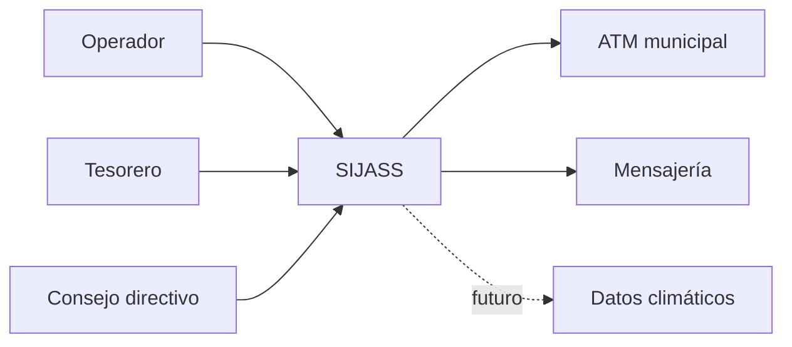

# 01. Actores e interesados — SIJASS
| Actor | Tipo | Objetivo | Funciones autorizadas |
|---|---|---|---|
| Operador técnico | Primario | Control de cloración en campo | Captura DPD, confirmación, operaciones offline |
| Tesorero | Primario | Administración de cuotas | Padrón, registrar pagos, morosidad |
| Consejo directivo | Primario | Gestión y supervisión | Reservorios, permisos, reportes y alertas |
| Área Técnica Municipal | Interesado externo | Fiscalización | Recibir informes autorizados |
| Asociados | Interesado | Calidad del agua y transparencia de cuotas | Consultas habilitadas en fases posteriores |
| Servicio de mensajería | Sistema externo | Notificar alertas | Entrega mediante adaptador |
| Datos climáticos | Sistema futuro | Análisis predictivo | Fuera del MVP |

## Contexto

**Regla:** La ATM y los asociados no son operadores administrativos del MVP.
