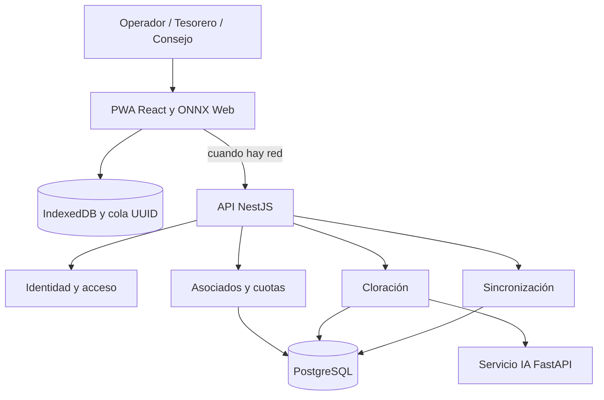

# Arquitectura inicial
La solución se basa en un **monolito modular** para identidad, asociados/cuotas, cloración y sincronización; PWA offline; servicio de validación IA separado.

**Reglas:** almacenamiento transaccional en PostgreSQL; comunicación TLS; lectura de cloro condicionada a revisión humana ante baja confianza. No se incluyen redes ni servicios productivos en este entregable.
