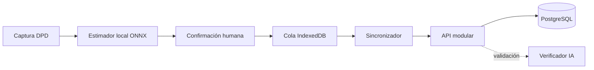

# Componentes arquitectónicos
| Componente | Entrada | Salida | Dependencias |
|---|---|---|---|
| CapturaDPD | Imagen | Captura validada | Cámara navegador |
| EstimadorCloro | Imagen validada | Estimación + confianza | ONNX local |
| ConfirmacionManual | Estimación | Medición confirmada | Operador |
| RegistroOffline | Comando | UUID pendiente | IndexedDB |
| Sincronizador | Lote UUID | Estado por elemento | API REST |
| Identidad | Credenciales/rol | Sesión autorizada | API NestJS |
| AsociadosCuotas | Altas y pagos | Padrón y movimientos | PostgreSQL |
| Reportes | Parámetros | Reporte | PostgreSQL |
| VerificadorIA | Lectura/imagen | Verificación posterior | Python FastAPI |

