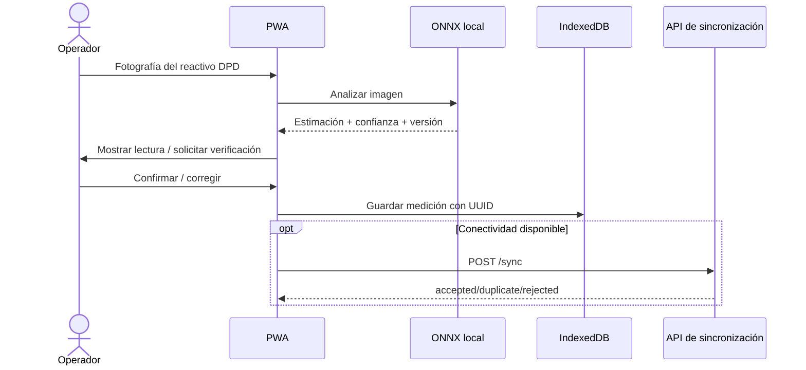
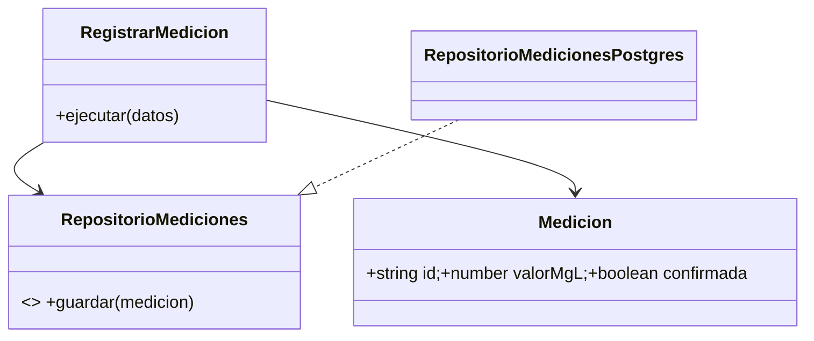

# Diseño interno de módulos
## Identidad
`Usuario(id, rol, activo)`; `AutenticarUsuario`, `AsignarRol`; `RepositorioUsuarios`. **Invariante:** acceso por privilegio mínimo.

## Asociados y cuotas
`Asociado(id, jassId, activo)`; `Cuota(id, asociadoId, periodo, monto)`; `Pago(id, cuotaId, importe, fecha)`; casos de uso `RegistrarAsociado`, `RegistrarPago`, `ConsultarMorosidad`. **Invariantes:** montos no negativos; cada pago conserva UUID idempotente y auditoría.

## Cloración
`Reservorio(id, volumenM3)`, `Medicion(id, reservorioId, valorMgL, confianza, modeloId, confirmada)` y `ReglaCloro` parametrizada. Casos de uso `RegistrarMedicion`, `ConfirmarMedicion`, `ConsultarHistorial`. **Invariante:** ninguna medición IA de baja confianza se presenta como resultado confirmado.

## Sincronización
`OperacionPendiente(uuid, tipo, payload, estado)`; `ProcesarLote` valida permisos, aplica idempotencia y devuelve un resultado individual por UUID.

## Secuencia de medición

## Paquetes

### Contratos API planeados
`POST /auth/login`, `GET /asociados`, `POST /pagos`, `POST /mediciones`, `GET /mediciones`, `POST /sync`, `GET /reportes/cloro`. Son contratos de diseño, no endpoints implementados en el prototipo.
