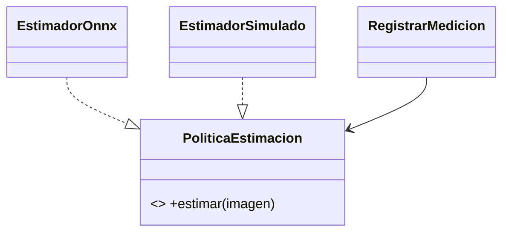

# Patrones de diseño en SIJASS
| Patrón | Dónde | Propósito |
|---|---|---|
| Repository | `RepositorioMediciones` | Independencia de PostgreSQL |
| Strategy | `PoliticaEstimacionCloro` | Cambiar ONNX/mock sin alterar aplicación |
| Adapter | `EstimadorOnnxAdapter`, `MensajeriaAdapter` | Integrar servicios externos |
| Factory | `FabricaOperacionSync` | Construir operaciones válidas |
| Facade | `ServicioControlCloracion` | Simplificar captura/confirmación/registro |
| Observer / Pub-Sub | `MedicionFueraDeRango` | Alertas desacopladas |

**Advertencia:** el prototipo implementa repositorio en memoria e idempotencia de operaciones; patrones de integraciones productivas son propuesta técnica.
