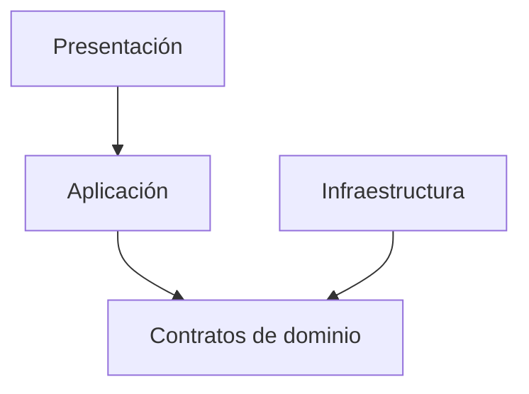

# Principios SOLID aplicados a SIJASS
| Principio | Aplicación |
|---|---|
| SRP | `Medicion` valida reglas; `RegistroMediciones` persiste; `Notificador` informa |
| OCP | Agregar otro estimador implementando el contrato, sin editar caso de uso |
| LSP | Un repositorio de memoria o PostgreSQL satisface el mismo contrato |
| ISP | Puertos acotados `RepositorioMediciones`, `NotificadorAlertas` |
| DIP | Los casos de uso dependen de contratos, no de FastAPI o PostgreSQL |

**Ejemplo:** `RegistrarMedicionCasoUso` recibe `RepositorioMediciones` por constructor. Cambiar el adaptador no cambia las reglas de negocio.

